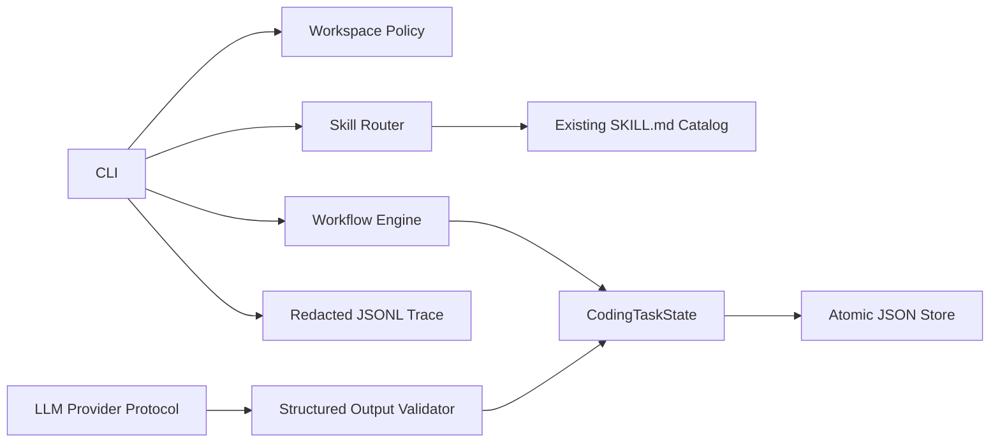
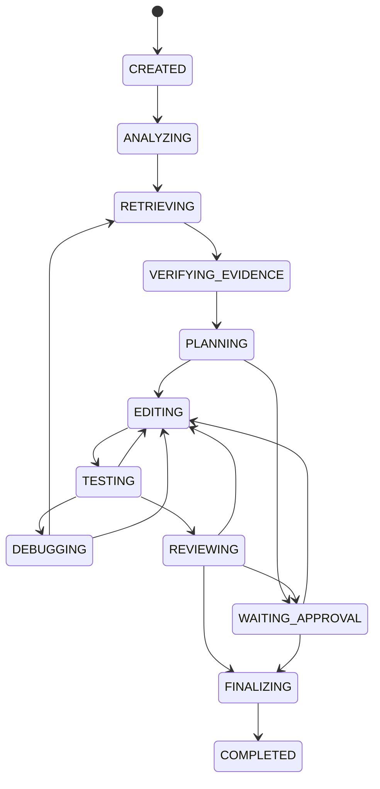
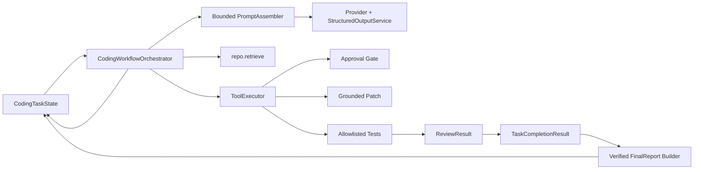

# System Architecture

## Phase 1

Task state là nguồn sự thật của workflow. Conversation không giữ độc quyền trạng thái. Skill được chọn theo trạng thái và lưu kèm path/content digest để lần chạy sau có thể phát hiện prompt drift.

## State flow

Mọi trạng thái đang chạy có thể chuyển sang `FAILED` theo transition policy. Maximum workflow iterations, repair iterations và retrieval retries bảo đảm quá trình dừng hữu hạn.

Plan execution persists its current step and completed step IDs. Testing is
two-stage (targeted then broad), while `DEBUGGING` requires a structured root
cause/evidence decision before repair, re-retrieval or failure.

## Hướng mở rộng

Phase 2 đã triển khai controlled MCP tools sau workspace policy và approval gate. Phase 3 đã bổ sung repository index/retrieval có citation, grounding và bounded stale recovery. Phase 4 đã kết nối structured LLM decisions, retriever và MCP thành agent loop bounded qua `CodingWorkflowOrchestrator`; mutation/test vẫn do controller và approval gate sở hữu.

Phase 5 bổ sung `ContextProjector`/`ContextCompactor`, `CheckpointStore` và
`ApprovalLedger`. Checkpoint được ghi trước operation rủi ro, có snapshot file
bytes để rollback, còn approval ledger độc lập với task JSON để chịu được gián
đoạn tiến trình.

Phase 6 bổ sung evaluation runner độc lập với provider, benchmark schema có
version, metric retrieval/coding-agent và failure analysis JSON; metric tùy chọn
không có sample sẽ trả `null` thay vì suy diễn.

## Phase 4 orchestration boundary

Batch 2 B2.5 keeps report assembly on the controller side. Model completion
fields are reconciled with modified-file, test, review and citation records
before `FinalReport` is persisted or the task can reach `COMPLETED`.
