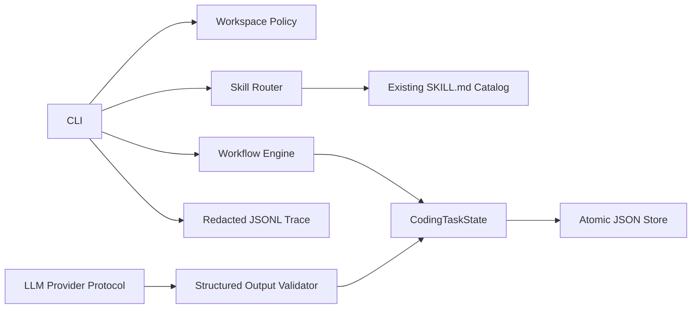
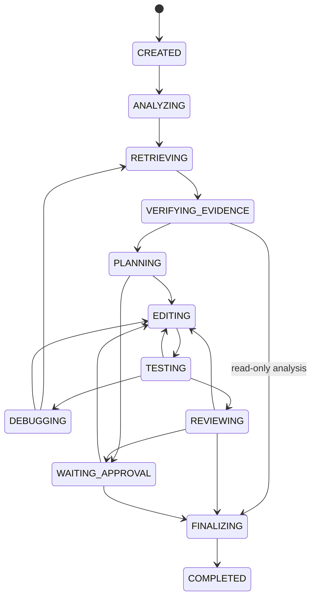
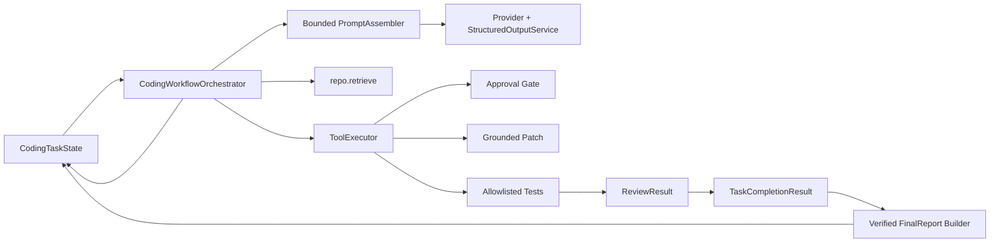

# System Architecture

## Phase 1

Task state là nguồn sự thật của workflow. Conversation không giữ độc quyền trạng thái. Skill được chọn theo trạng thái và lưu kèm path/content digest để lần chạy sau có thể phát hiện prompt drift.

Workspace policy tách write scope khỏi dependency chỉ-đọc: repository tools,
runtime state và patches luôn bị giữ trong target workspace; skill catalog tuyệt
đối do người vận hành chỉ định có thể nằm ngoài workspace nhưng không được trao
cho mutation tools. Cả hai loại đường dẫn vẫn áp dụng forbidden-drive policy.

## State flow

Mọi trạng thái đang chạy có thể chuyển sang `FAILED` theo transition policy. Maximum workflow iterations, repair iterations và retrieval retries bảo đảm quá trình dừng hữu hạn.

Plan execution persists its current step and completed step IDs. Testing is
two-stage (targeted then broad), while `DEBUGGING` requires a structured root
cause/evidence decision before repair, re-retrieval or failure.

## Hướng mở rộng

Phase 2 đã triển khai controlled MCP tools sau workspace policy và approval gate. Phase 3 đã bổ sung repository index/retrieval có citation, grounding và bounded stale recovery. Phase 4 đã kết nối structured LLM decisions, retriever và MCP thành agent loop bounded qua `CodingWorkflowOrchestrator`; mutation/test vẫn do controller và approval gate sở hữu.

Project discovery chạy offline trước task mới. `ProjectInspector` ghi snapshot
manifest, ecosystem, package manager và candidate argv nhưng không thực thi.
`InstructionResolver` áp dụng `CLAUDE.md` rồi `AGENTS.md` từ root đến scope sâu,
giới hạn byte/file, giữ SHA-256 provenance và từ chối symlink thoát workspace.
Context đánh dấu toàn bộ instruction là `untrusted_repository_data`; controller
policy, approval, read-only và workspace boundary luôn có quyền cao hơn.

Layered policy giữ validation tool/path hiện hữu làm facade, sau đó đánh giá
typed risk qua immutable built-ins, trusted explicit TOML, workspace deny-only
rules và session mode. `WorkspaceTrust` độc lập `ApprovalMode`; một approval
không được coi là process isolation. Mọi decision có rule/layer/reason ổn định
và arguments đã redact để phục vụ event stream ở phase sau.

Phase 5 bổ sung `ContextProjector`/`ContextCompactor`, `CheckpointStore` và
`ApprovalLedger`. Checkpoint được ghi trước operation rủi ro, có snapshot file
bytes để rollback, còn approval ledger độc lập với task JSON để chịu được gián
đoạn tiến trình.

Phase 6 bổ sung evaluation runner độc lập với provider, benchmark schema có
version, metric retrieval/coding-agent và failure analysis JSON; metric tùy chọn
không có sample sẽ trả `null` thay vì suy diễn.

Production completion bổ sung `OpenAIResponsesProvider`,
`OpenRouterResponsesProvider`, batched `OpenAIEmbeddingProvider` và
`workflow.runtime`. CLI `run` tạo hoặc resume task,
lưu sau mỗi attempted step, dừng approval theo mặc định và chỉ tự duyệt khi có
`--auto-approve`. CI giữ deterministic embeddings và provider fixtures để không
phụ thuộc credential/network.

Model provider selection is run-scoped: OpenAI remains default, while OpenRouter
uses `--model-provider openrouter` and `OPENROUTER_API_KEY`. Both pass through the
same bounded structured-output and orchestration contracts; model selection does
not change the embedding provider or controlled-tool policy.

`ContextProjector` includes an explicit schema for each decision type. Coding
tasks retain the plan/edit/test/review/final-diff invariants. Explicit read-only
analysis is pinned by controller-owned `read_only=true`, stores
`task_type=analysis`, skips all mutation-capable stages, and uses
an analysis-specific completion contract whose controller-built report rejects
any recorded mutation or test execution.

## Phase 4 orchestration boundary

Batch 2 B2.5 keeps report assembly on the controller side. Model completion
fields are reconciled with modified-file, test, review and citation records
before `FinalReport` is persisted or the task can reach `COMPLETED`.
