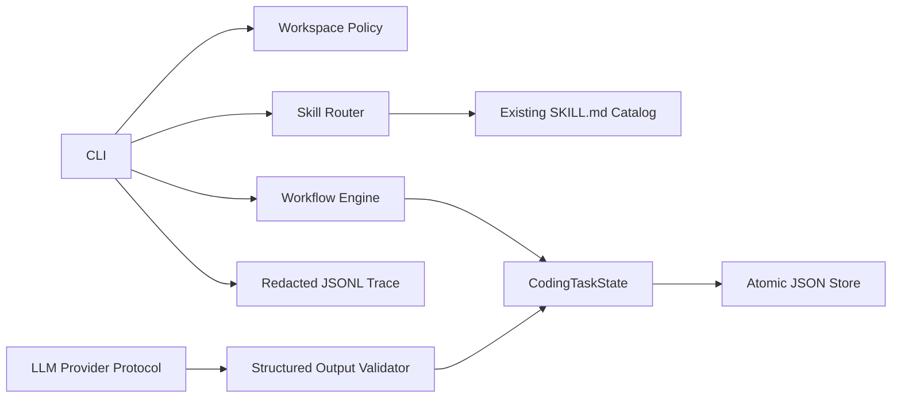
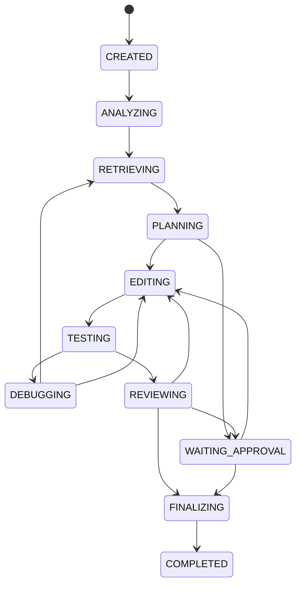

# System Architecture

## Phase 1

Task state là nguồn sự thật của workflow. Conversation không giữ độc quyền trạng thái. Skill được chọn theo trạng thái và lưu kèm path/content digest để lần chạy sau có thể phát hiện prompt drift.

## State flow

Mọi trạng thái đang chạy có thể chuyển sang `FAILED` theo transition policy. Maximum workflow iterations, repair iterations và retrieval retries bảo đảm quá trình dừng hữu hạn.

## Hướng mở rộng

Phase 2 đặt controlled MCP tools sau workspace policy và approval gate. Phase 3 bổ sung repository index/retrieval có citation. Phase 4 mới kết nối LLM, retriever và MCP thành agent loop hoàn chỉnh.
